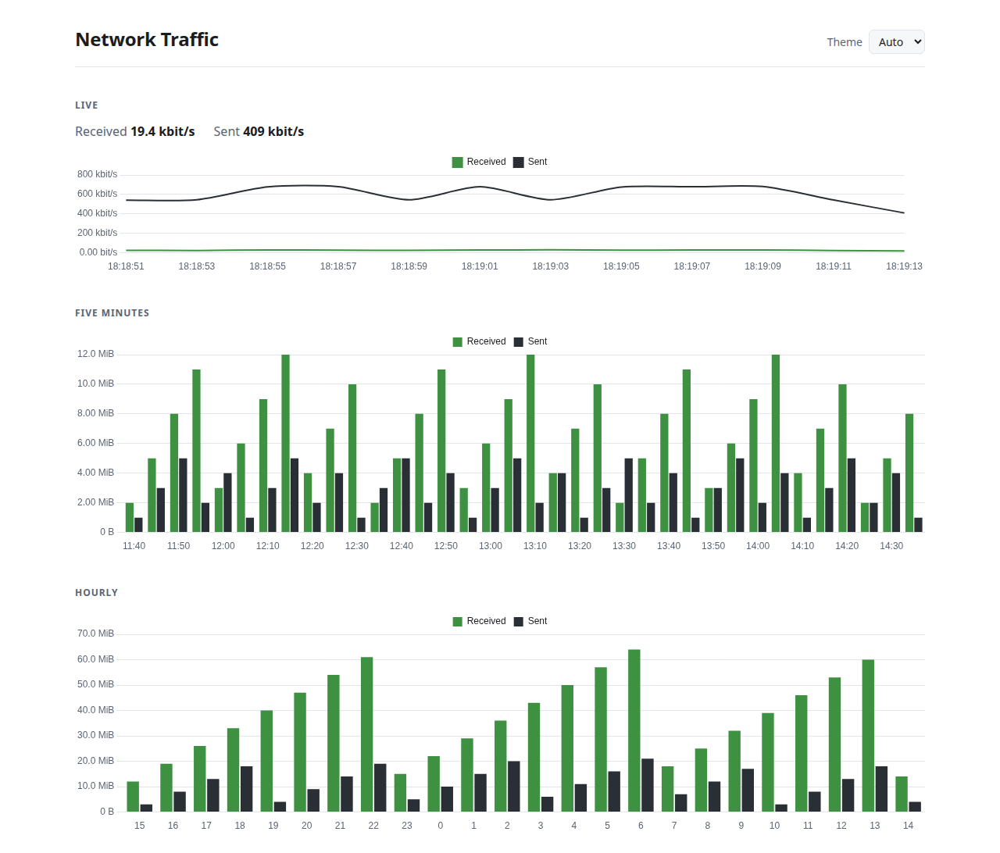

# vnStat-PHP

A small PHP frontend for [vnStat](https://humdi.net/vnstat/) that shows what
your network interfaces have been doing, by hour, day and month, and which
days were busiest.

<picture>
    <source media="(prefers-color-scheme: dark)" srcset="docs/example-dark.webp">
    
</picture>

## Requirements

- PHP 8.2 or newer, with the intl extension
- vnStat 2.0 or newer, reachable on the `PATH` of the user your web server
  runs as
- `shell_exec()` not listed in `disable_functions`, since that is how vnStat
  is called

Run vnStat as a daemon so it has data to report. It can run in user mode
instead, which the vnStat documentation covers.

The web server user needs to be able to read vnStat's database. If the page
reports that vnStat returned no JSON, run the same command as that user to
see why, for example `sudo -u www-data vnstat --json`, substituting whichever
user your PHP-FPM pool or web server runs as.

## Installing

Download `vnstat-php-<version>.tar.gz` from the [latest
release](https://github.com/DASPRiD/vnstat-php/releases/latest), extract it,
and point a virtual host at the `public` directory inside. Nothing else to
build or install.

Take that file rather than the "Source code" archives GitHub lists beside it.
Those are the bare repository, without the dependencies or the built assets,
and the page will not run from one.

## Configuring interfaces

Without configuration the page shows the first interface vnStat reports. To
pick a different one, or to switch between several, copy
`config/config.php.dist` to `config/config.php` and list them there. The
first is the default, and a dropdown appears when there is more than one.

## Upgrading from an earlier version

Point your virtual host at the `public` directory rather than at the top of
the tree. If you had a `config.php` at the top, move it to
`config/config.php`; the page will refuse to start until you do, rather than
quietly ignoring it.

## Developing

```sh
composer install
pnpm install
pnpm run build
php -S localhost:8080 -t public
```

`pnpm run build` copies Chart.js into `public/assets`, which is not committed.

Checks, all of which also run in CI across PHP 8.2 to 8.5:

```sh
./bin/lint.sh        # compiles every file, fails on any diagnostic
./vendor/bin/phpunit
./bin/smoke-test.sh  # renders the page against the captured fixtures
```

The fixtures under `tests/fixtures` come from real vnStat binaries run
against a synthetic database, rather than being written by hand.
`bin/generate-fixture.sh` recreates them; which vnStat version you get
depends on the container you run it in.

## License

MIT, see [LICENSE](LICENSE).
