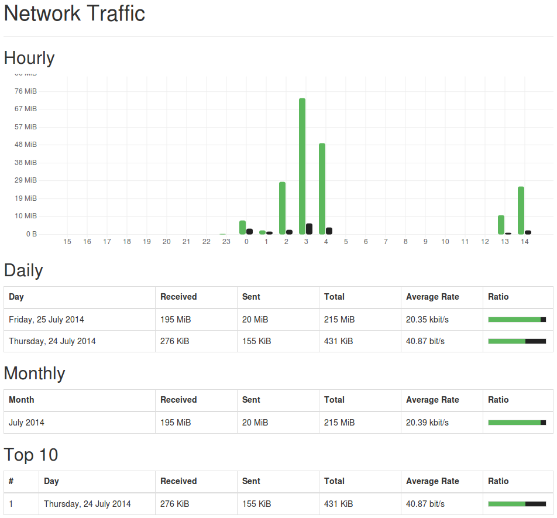

# vnStat-PHP

This is a simple PHP frontend for vnStat to nicely display statistics about
your network traffic. All you have to do is to install vnStat 2.0 or newer on
your system. Preferably you run it as daemon, but you can theoretically also
run it in user mode, please refer to the vnStat documentation. After that, run
"composer install" and point a virtual host at the "public" directory.

## Configuring multiple or different interfaces

You can change the used interface or add more by copying the
"config/config.php.dist" file to "config/config.php" and adjusting the values
in it.

## Upgrading from an earlier version

The document root moved into the "public" directory, so point your virtual host
there instead of at the repository root. If you had a "config.php" at the
repository root, move it to "config/config.php".

## Example output

